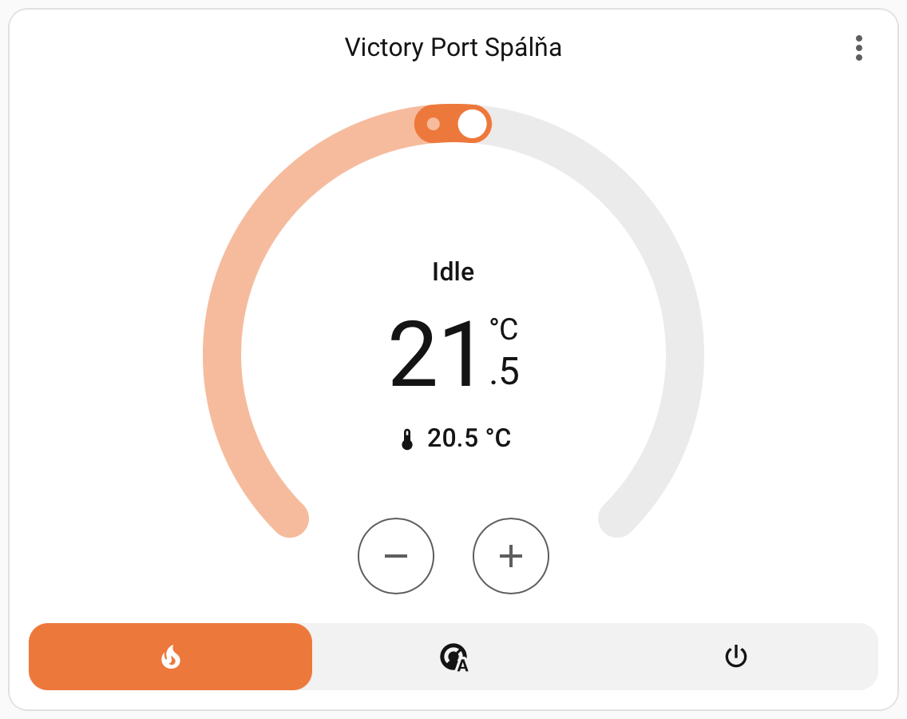
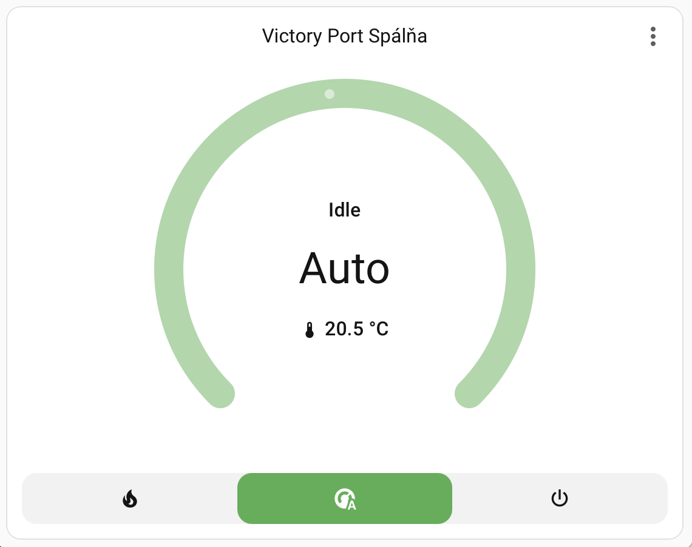
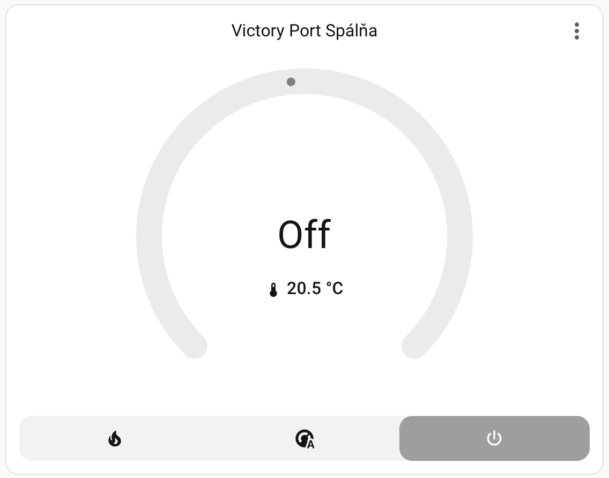

# FENIX TFT WiFi Home Assistant Integration

This is a custom Home Assistant integration for the [FENIX TFT WiFi thermostat](https://www.fenixgroup.cz/en/products/thermostat-fenix-tft-wifi).

**🏠 Smart Thermostat Control** **⚡ Energy Monitoring** **🌡️ Multi-Sensor Support** **📊 Energy Dashboard**

## Screenshots

Here is the thermostat integration in action.

<p float="left">
  
  
  
</p>

## Project status

- **Developed in cooperation with FENIX**: Since October 2026, this integration has been developed in cooperation with [FENIX Trading s.r.o.](https://www.fenixgroup.cz/en/), the maker of the thermostats, which provides technical support, documentation and test devices.
- **Coming to Home Assistant**: The same work brings the thermostats into Home Assistant itself as the **FENIX Control** integration ([home-assistant/core#187322](https://github.com/home-assistant/core/pull/187322), in review). This custom integration stays available and keeps the features that aren't in Home Assistant yet, such as holiday schedules and the historical energy import.
- **Support**: Report problems in this repository's [issue tracker](https://github.com/baracudaz/fenix_tft/issues).

## Features

- **Climate Control**: Temperature control (in the range each thermostat accepts, usually 5–35 °C; 0.5 °C steps), heating modes (Off/Manual/Program), real-time monitoring
- **Energy Monitoring**: Daily consumption tracking with Home Assistant Energy Dashboard integration
- **Holiday Mode**: Set and cancel holiday schedules with automatic control locking during holidays
- **Multi-Sensor Support**: Room/floor temperatures, target & difference metrics, HVAC status, connectivity, energy, holiday state & end timestamp
- **Multi-Device**: Supports multiple thermostats across different rooms
- **Reconfigure**: Update credentials without removing and re-adding the integration
- **Diagnostics**: Built-in diagnostics panel for troubleshooting (redacts sensitive data)
- **Repair Issues**: Automatic repair notification after repeated cloud connectivity failures
- **API Resilience**: Automatic retry with exponential backoff for transient server errors
- **Energy Import Deduplication**: Re-import aware historical import that backfills only missing older periods to prevent duplicate statistics and double-counting

### 💡 Contributing

Help wanted with testing, translations, documentation, and feature requests!

## Development

### Prerequisites

- Python 3.14+
- Docker + Docker Compose (optional, for running Home Assistant in a container instead of a local `.venv`)

### Quick start

```bash
make install  # Create .venv and install all dependencies
make develop  # Start Home Assistant dev server (opens browser automatically)
```

Alternatively, run Home Assistant in Docker via `docker-compose.yml`:

```bash
make docker-up    # Start Home Assistant, opens http://localhost:8123, then follows logs
make docker-down  # Stop and remove the container
```

### Common tasks

| Command | Description |
| --------- | ------------- |
| `make install` | Create `.venv` and install all dependencies (incl. test extras) |
| `make develop` | Start HA dev server from `.venv`, opens `http://localhost:8123` |
| `make docker-up` | Start Home Assistant in Docker via `docker-compose.yml`, opens browser, follows logs |
| `make docker-down` | Stop and remove the Docker container |
| `make docker-logs` | Re-attach to follow Home Assistant container logs |
| `make docker-restart` | Restart the container, then follow recent logs |
| `make lint` | Format and lint code with Ruff |
| `make test` | Run all tests |
| `make translations` | Check translation files against `translations/en.json` |
| `make clean` | Remove cache files and build artifacts |

### Translations

This integration follows the Home Assistant custom integration translation model.

- `custom_components/fenix_tft/translations/en.json` is the English source used by Home Assistant at runtime
- Additional locale files in `custom_components/fenix_tft/translations/` should stay aligned with `en.json`
- `make translations` runs the repository check script and reports missing or extra translation keys

## Getting started

### Login credentials

To use this integration, you only need your **FENIX account email and password**.  

### Installation

#### Home Assistant 2026.11 and newer: Marketplace

Since 2026.11, HACS is built into Home Assistant as the **Marketplace**, and HACS can no longer be installed on its own. This integration isn't in the Marketplace catalog, so add it from its link:

[](https://my.home-assistant.io/redirect/marketplace_repository/?owner=baracudaz&repository=fenix_tft)

Or add it by hand:

1. Go to **Settings → Marketplace**. The first time, accept the warning about community content.
2. Select **Add from link** in the upper right, enter `https://github.com/baracudaz/fenix_tft` as the **GitHub link** and select **Add**.
3. Open **Fenix TFT WiFi Thermostat** in the list and install it.
4. Set up the integration in the dialog that opens, with your **email** and **password**. If you close it, or the Marketplace asks you to restart first, add it later via **Settings → Devices & Services → Add Integration**.

Adding and updating repositories from a link requires a GitHub connection, which the Marketplace asks for when needed.

If you installed this integration with HACS before 2026.11, there's nothing to do: Home Assistant moves it into the Marketplace, where updates now show up.

#### Home Assistant 2026.10 and older: HACS

Releases after 1.6.3 need Home Assistant 2026.11 or newer. On older versions, HACS can install up to 1.6.3.

The quick-add button opens HACS with this repository pre-filled:

[](https://my.home-assistant.io/redirect/hacs_repository/?owner=baracudaz&repository=fenix_tft&category=integration)

Or add it by hand:

1. Open [HACS](https://www.hacs.xyz) in your Home Assistant instance.
2. Click the three-dot menu **⋮** in the top right and select **Custom repositories**.
3. Enter `https://github.com/baracudaz/fenix_tft` as the repository URL and select **Integration** as the category, then click **Add**.
4. Search for **Fenix TFT** in HACS and install it.
5. Restart Home Assistant.
6. Add the integration via **Settings → Devices & Services → Add Integration** and provide your **email** and **password**.

> **Note:** This is an integration, not an app (add-on). Add the repository in the **Marketplace** or **HACS**, not in the app or add-on store, which will show "not a valid add-on repository".

#### Manual installation

1. Clone this repository into your Home Assistant `custom_components` folder:

    ```bash
    git clone https://github.com/baracudaz/fenix_tft.git custom_components/fenix_tft
    ```

2. Restart Home Assistant.
3. Add the integration via **Settings → Devices & Services → Add Integration** and provide your **email** and **password**.

### Configuration

- During setup, you will be prompted for your **email** and **password** used in the FENIX Control app.
- The integration will take care of acquiring and refreshing tokens automatically in the background.

## Services

The integration provides three services for managing holiday schedules and importing historical energy data.

### `fenix_tft.set_holiday_schedule`

Set a holiday schedule for all thermostats in the installation. This overrides the normal weekly program for the specified period.

**Parameters:**

- `entity_id` (required): Any thermostat entity from the installation (schedule applies to all thermostats sharing its installation)
- `start_date` (required): When the holiday schedule should start
- `end_date` (required): When the holiday schedule should end

TFT thermostats round the start and end down to the full hour: a holiday from 15:25 to 17:23 runs from 15:00 to 17:00. The WiFi Box keeps the exact times.

- `mode` (required): Heating mode during the holiday period
  - `off`: Turn heating off completely
  - `reduce`: Eco/reduced temperature mode
  - `defrost`: Defrost mode (frost protection)
  - `sunday`: Use Sunday schedule

**Example automation:**

```yaml
automation:
  - alias: "Set vacation mode"
    trigger:
      - platform: calendar
        entity_id: calendar.vacation
        event: start
    action:
      - service: fenix_tft.set_holiday_schedule
        data:
          entity_id: climate.your_thermostat
          start_date: "{{ now() }}"
          end_date: "{{ states('calendar.vacation').as_datetime }}"
          mode: "reduce"
```

### `fenix_tft.cancel_holiday_schedule`

Cancel the active or scheduled holiday, returning all thermostats to their normal weekly program.

**Parameters:**

- `entity_id` (required): Any thermostat entity from the installation (cancellation applies installation-wide)

**Example automation:**

```yaml
automation:
  - alias: "Cancel vacation mode when home"
    trigger:
      - platform: state
        entity_id: person.john
        to: "home"
    action:
      - service: fenix_tft.cancel_holiday_schedule
        data:
          entity_id: climate.your_thermostat
```

**Note:** Holiday schedules apply to all thermostats in an installation (all devices in your home). During an active holiday period, thermostat controls are automatically locked to prevent conflicts.

### `fenix_tft.import_historical_statistics`

Import historical energy consumption data as external statistics. This service intelligently detects existing data and backfills only older data to prevent duplicates and double-counting. Data is imported as a separate external statistic (e.g., `fenix_tft:bedroom_daily_energy_consumption_history`) to avoid interfering with the main sensor's current data.

**Smart Aggregation:** The service automatically uses the optimal data granularity:

- **Hourly data** for the most recent 7 days
- **Daily data** for 8-90 days back
- **Monthly data** for 91+ days back

**Parameters:**

- `energy_entity` (required): Energy sensor to import data for (e.g., `sensor.bedroom_daily_energy_consumption`)
- `days_back` (optional): Number of days of historical data to import (1-365). Ignored when `import_all_history: true`
- `import_all_history` (optional): Import all available historical data in progressive yearly batches instead of a fixed day range

**Behavior:**

- If no statistics exist: Imports data starting from the requested number of days ago, ending at midnight of today (start of current day in your timezone) to avoid overlap with today's sensor data
- If statistics exist: Detects the first recorded data point and imports the requested number of days ending at midnight of the day when existing data begins, ensuring no overlap
- Example: If data exists from Oct 25 10:00 and you request 30 days, it imports Sept 25 00:00 to Oct 25 00:00 (midnight boundaries)
- If `import_all_history` is enabled: Walks backwards in yearly batches, prepending older statistics and rebasing later cumulative sums so the imported history stays continuous

**Example service call:**

```yaml
service: fenix_tft.import_historical_statistics
data:
  energy_entity: sensor.bedroom_daily_energy_consumption
  days_back: 30
```

**Example full-history import:**

```yaml
service: fenix_tft.import_historical_statistics
data:
  energy_entity: sensor.bedroom_daily_energy_consumption
  import_all_history: true
```

**Use cases:**

- Initial setup: Import historical data to populate the Energy Dashboard
- Data gaps: Backfill missing periods after connectivity issues
- Migration: Import data when moving from another system

**Note:** Imported data appears as a separate external statistic (e.g., `fenix_tft:bedroom_daily_energy_consumption_history`) that can be added to the Energy Dashboard. This keeps historical imports separate from the main sensor's current data. The service maintains cumulative sum continuity and aligns with Home Assistant's hourly statistic buckets to prevent double-counting. Hourly data is booked in the hour it covers: the cloud stamps each hourly bucket with the end of its hour, so the import moves it one hour back.

## Sensors

Each thermostat provides a set of sensors you can use in dashboards, automations, and energy tracking:

| Sensor | Description |
| -------- | ------------- |
| `*_ambient_temperature` | Current room temperature (°C). |
| `*_floor_temperature` | Floor probe temperature (°C). Only if the thermostat reports one; TFT Wi-Fi thermostats currently don't ([#183](https://github.com/baracudaz/fenix_tft/issues/183)). |
| `*_target_temperature` | Target temperature (°C). |
| `*_temperature_difference` | Target minus current temperature (°C). |
| `*_floor_air_difference` | Floor minus ambient temperature (°C). Same condition as the floor temperature. |
| `*_hvac_state` | Heating state: `heating`, `idle`, `off`. |
| `*_connectivity_status` | `connected` / `disconnected`. |
| `*_daily_energy_consumption` | Accumulated energy for today (Wh). |
| `*_holiday_mode` | Display name of the current holiday mode or `None`. Includes rich attributes. |
| `*_holiday_schedule_until` | Timestamp when the holiday ends (if active). |

## Energy in the Energy Dashboard

The FENIX cloud reports energy per room as hourly buckets. A bucket is published
about 1.5–2 hours after its hour ends, and is stamped with the end of the hour it
covers. Two sources are available:

- **"<installation> <room> energy (hourly)"** (external statistic
  `fenix_tft:energy_<room id>`, recommended): each bucket is booked in the hour it
  covers, so the Energy Dashboard matches a grid meter hour by hour. The last
  hours fill in as their buckets arrive, including after midnight. There is one
  statistic per room, even if the room has several thermostats.
- `*_daily_energy_consumption`: today's buckets, restarts at midnight. It shows
  energy about two hours late and misses buckets of the last evening hours that are
  published after midnight. If a room has several thermostats, each one reports the
  room's energy.

Add only one source per room to the Energy Dashboard. Don't combine the hourly
statistic with a "(History)" statistic from `import_historical_statistics` for the
same room and period; the overlapping hours would be counted twice.

## Energy is calculated, not measured

The thermostat has no power meter. The cloud's energy is the time the heating relay
was on multiplied by the heater power configured on the thermostat. It can differ
from your electricity meter:

- **Heater power setting**: if the configured power (often a default of 1 kW)
  is higher or lower than the real power of the heating mat or cable, every
  hour is off by the same ratio. Set the installed power of the mat or cable on
  the thermostat itself (Settings (gear) → Statistics → Heating power; the
  TFT Wi-Fi RF has separate levels for its wired and RF outputs). It can't be
  changed from Home Assistant.
- **Tariffs with ripple control (HDO)**: on direct-heating tariffs the
  distributor switches the heating circuits off for a few hours a day. The
  thermostat has no input for the blocking signal. It's usually wired so that
  HDO switches it off together with the heating, and then nothing is counted.
  If the thermostat stays powered during blocking, it keeps counting while the
  room cools, so energy is reported for hours in which the heater got no
  current ([#179](https://github.com/baracudaz/fenix_tft/issues/179)).

The integration shows the energy as the cloud reports it and doesn't correct it.

## Known limitations

These come from what the FENIX cloud reports, so the integration can't show or change them:

- **Floor temperature:** not reported for TFT Wi-Fi thermostats, even with a floor probe connected ([#183](https://github.com/baracudaz/fenix_tft/issues/183)).
- **Open-window detection and the floor temperature limit** (warning triangle on the display) are not reported. When the thermostat stops heating because of an open window or the floor limit, it looks the same as a thermostat that has reached its target.
- **Professional Mode** (touchscreen lock) is not reported. Commands from Home Assistant still work while it's on.
- **Other settings made on the thermostat** (Boost duration, heater power) can't be changed from Home Assistant. The Defrost and Boost temperatures can: change the target while the thermostat is in Defrost or Boost.

## Product information

- [FENIX TFT WiFi Thermostat product page](https://www.fenixgroup.cz/en/products/thermostat-fenix-tft-wifi)
- [FENIX Control app on Apple App Store](https://apps.apple.com/ch/app/fenix-control/id1474206689?l=en-GB)
- [FENIX Control app on Google Play](https://play.google.com/store/apps/details?id=com.Fenix.TftWifi.Mobile)

---

Feel free to contribute, open issues, or share feedback as you explore and extend this integration!
